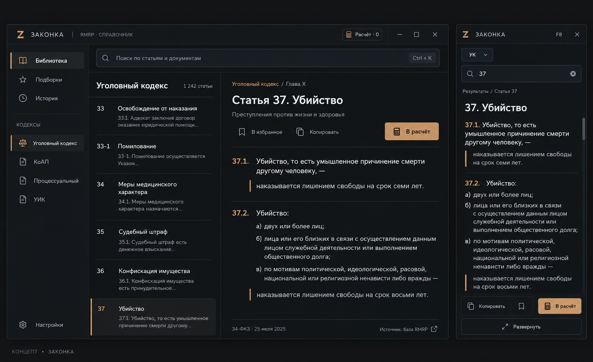

# Внешний вид «Законки»: предлагаемое направление

Дата: 21 октября 2026. Статус: предложение для обсуждения, не готовая версия.
Пользователь считает текущий внешний вид дешёвым. Все 19 функциональных идей
согласованы; выбор конкретного нового оформления остаётся открытым.

## Визуальный концепт

Изображение создано для оценки оформления на основе снимков alpha. Это не
снимок новой сборки. При реализации текст, счётчики и сведения об источнике
должны поступать из реальных данных приложения, а не переноситься с изображения.

## Что видно на текущих снимках

- На Windows-снимке почти весь текст выглядит жирным, включая саму статью.
  Это мешает различать заголовок, содержание и служебные подписи. Снимок получен
  в Wine; шрифты и вес дополнительно проверить на настоящей Windows.
- У списков, статьи, поиска и действий много одинаково заметных рамок и заливок.
  Границы занимают внимание наравне с содержанием.
- В основном окне повторяются входы в расчёт и оверлей: и в навигации, и сверху.
- В оверлее выбранная статья показана карточкой результата, отдельным заголовком
  и текстом. На чтение остаётся небольшая часть окна.
- Надписи, размеры кнопок и плотность требуют единой системы: отделить основные
  действия от вспомогательных, привести отступы и иконки к общему масштабу.

## Предлагаемое направление

Спокойный настольный справочник с акцентом на текст. Тёплый графит, мягкий белый
и небольшой приглушённый медный акцент. Это вариант для оценки, а не утверждённая
палитра. Один узнаваемый знак и сдержанный набор иконок.

Отправная палитра: фон #151617, боковая панель #1A1C1E, поверхность #202225,
основной текст #EEECE7, вторичный текст #ABB0B4, акцент #C7A47B.
Контраст и читаемость проверяются на готовом прототипе, а не считаются
обеспеченными самим выбором этих значений.

Текст интерфейса — Inter или системный Segoe UI с проверкой кириллицы.
Обычный текст статьи regular, заголовки semibold, служебные подписи спокойнее
по цвету и размеру. Примерные размеры на 100% масштаба: интерфейс 13–14 px,
текст статьи 16–18 px, заголовок 26–30 px. Ширина чтения около 65–80 знаков;
межстрочное расстояние и размер доступны пользователю.

## Главное окно

- Узкая навигация: библиотека, подборки, история; настройки внизу.
- Единая строка поиска сверху. Дополнительные инструменты открываются по действию.
- Список статей — ровные строки с тонкими разделителями; активная строка имеет
  сдержанное выделение. Название документа не повторяется без необходимости.
- У статьи есть понятная шапка: документ и номер, название, отдельная строка
  действий. Основной текст расположен на спокойной поверхности без вложенных
  декоративных карточек. Полный исходный текст сохраняется.
- Расчёт выдвигается сбоку, когда нужен. Итог и основное действие заметнее
  служебных подписей. В режиме чтения боковые панели сворачиваются.

## Оверлей

- Компактная шапка с названием, кодексом, клавишей вызова и закрытием.
- В режиме чтения результаты поиска сворачиваются: выбранная статья получает
  основную высоту окна. Возврат к результатам сохраняет запрос и выбранную строку.
- Минимальный набор действий внизу; подробные настройки находятся в основном окне.
- Читаемость проверяется на светлом, тёмном и пёстром игровом фоне. Прозрачность
  не должна делать сам текст бледным; фон и текст требуют отдельного контроля.
- Два согласованных режима — компактная полоска и развёрнутая панель — оформлены
  одним набором размеров, шрифтов, иконок и состояний.

## Детали, которые доводятся вместе

- Единая сетка отступов 4/8 px, ограниченный набор скруглений и размеров кнопок.
- Одинаковый рисунок и толщина иконок, читаемые подписи к неоднозначным действиям.
- Продуманные состояния наведения, нажатия, выбора, фокуса и недоступного действия.
- Короткие переходы около 100–160 ms при поддержке отключения анимации.
- Аккуратные настройки, подсказки, пустые результаты и сообщения об ошибках:
  визуальное качество распространяется на все окна.
- Приложение остаётся удобным при работе с клавиатуры, на узком окне и при
  увеличенном масштабе. Контраст, фокус и размер целей проверяются в прототипе.

## Следующий конкретный результат

Показать концепт главного окна и оверлея на реальной статье. Изображение явно
обозначить как концепт; оно не доказывает работу функций. После обсуждения
перенести выбранное направление в реальные Qt-компоненты и сравнить снимки
на Windows при 100%, 125% и 150%, с длинным текстом, расчётом и пустым поиском.
Пересборка программы и реализация согласованных функций выполняются позже.
